# Existing state machines

The backend contains several independent lifecycles inside the same record. A successful payment does not necessarily grant access, an archived record is not necessarily inactive, and a queued message is not necessarily delivered. This map preserves those distinctions and connects them to the browser workflows in the [frontend map](../../BelivrHQ-Web/docs/STATE-MACHINES.md).

Snapshot: 14 November 2026, updated with the [transition corrections](STATE-TRANSITION-FIXES-2026-11-14.md). The IDs below identify documentation entries, not new application types. These maps describe current implementation; they do not introduce transition rules or certify concurrency safety.

## Machine index

- [B01 Subscription charge and B02 checkout attempt](#b01-subscription-charge-and-b02-checkout-attempt)
- [B03 Payment application](#b03-payment-application)
- [B04 Refund and reversal facts and B05 disputes](#b04-refund-and-reversal-facts-and-b05-disputes)
- [B06 Financial access decision](#b06-financial-access-decision)
- [B07 Access grants and B08 workspace entitlement](#b07-access-grants-and-b08-workspace-entitlement)
- [B09 Renewal preference](#b09-renewal-preference)
- [B10 Giving transaction](#b10-giving-transaction)
- [B11 Recurring giving](#b11-recurring-giving)
- [B12 Event registration payment and B13 ticket validity](#b12-event-registration-payment-and-b13-ticket-validity)
- [B14 Ticket ownership and B15 ticket consumption](#b14-ticket-ownership-and-b15-ticket-consumption)
- [B16 Member status and B17 visitor follow-up](#b16-member-status-and-b17-visitor-follow-up)
- [B18 Public people intake](#b18-public-people-intake)
- [B19 Form publication and B20 submission review](#b19-form-publication-and-b20-submission-review)
- [B21 Appointments](#b21-appointments)
- [B22 Asset lifecycle B23 maintenance and B24 loans](#b22-asset-lifecycle-b23-maintenance-and-b24-loans)
- [B25 Staff account and B26 seat reservation](#b25-staff-account-and-b26-seat-reservation)
- [B27 Shared archive and B28 enablement](#b27-shared-archive-and-b28-enablement)
- [B29 Template publication](#b29-template-publication)
- [B30 Broadcast campaign and B31 recipient enqueue outcome](#b30-broadcast-campaign-and-b31-recipient-enqueue-outcome)
- [B32 Message delivery B33 company outbox and B34 queue execution](#b32-message-delivery-b33-company-outbox-and-b34-queue-execution)
- [B35 Webhook delivery](#b35-webhook-delivery)
- [B36 Credential verification and B37 channel routing](#b36-credential-verification-and-b37-channel-routing)
- [B38 Internal email copies and B39 notifications](#b38-internal-email-copies-and-b39-notifications)
- [B40 Server change feed and B41 offline mutation receipts](#b40-server-change-feed-and-b41-offline-mutation-receipts)
- [B42 Login challenges B43 enrollment B44 session approval and B45 recovery codes](#b42-login-challenges-b43-enrollment-b44-session-approval-and-b45-recovery-codes)
- [B46 Direct media upload authorization](#b46-direct-media-upload-authorization)
- [B47 Bot challenge replay protection](#b47-bot-challenge-replay-protection)

## Reading the maps

- **Stored** state comes from database fields, JSON, Redis keys, or queue state.
- **Derived** state is calculated from time, other records, or several stored fields. Capitalized descriptive diagram labels are conceptual names, not additional persisted values.
- **Guarded** means a named operation checks its source state. A precheck followed by an unconditional write is not an atomic transition claim.
- **Direct edit** means an update accepts an allowed destination status without a complete source-to-destination transition matrix.
- Arrows show implemented operations. A final node means that operation has no continuation in the mapped path; it does not imply the row can never be changed by another writer.
- Tenant, branch, permission, and plan guards continue to apply at the owning controller/service. Tables call out additional lifecycle guards.

## System relationships

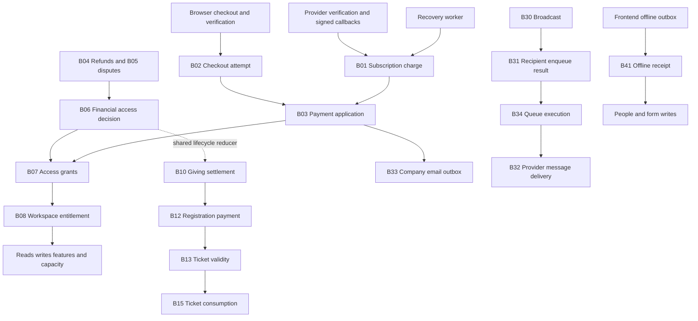

The charge, checkout, application, grant, and entitlement states are separate axes. Ticket validity, ownership, and consumption are also separate axes. UI and provider callbacks are inputs to server verification, not evidence of paid access by themselves.

## Subscription payments and access

### B01 Subscription charge and B02 checkout attempt

**Owner:** [BillingService](../src/billing/billing.service.ts), [recovery scanner](../src/billing/payment-reconciliation.service.ts), [payment schema](../prisma/schema.prisma#L307).

**Stored:** charge `status`, provider identity and `verified_at`; checkout `checkout_url`, `checkout_closed_at`, `checkout_close_reason`. Preparing/open/closed are projections of those fields.

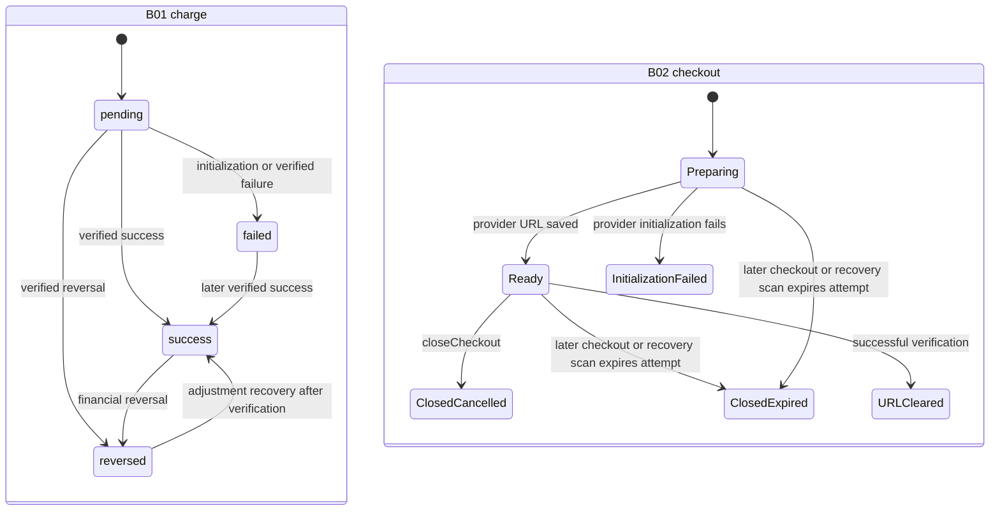

| Event | Guard and transition | Effects and recovery |
| --- | --- | --- |
| Start checkout | Church row lock; only one pending, unclosed attempt is reused. Mismatched plan, cycle, gateway, currency or quote conflicts. | Freeze quote/baseline and create pending payment before provider I/O. Current subscription checkout admits Flutterwave only. |
| Initialize provider | Trusted return origin and checkout URL; returned reference must match. | Save URL, or mark still-pending attempt failed. A late success can still recover it. |
| Close checkout | Conditional write requires pending and unclosed. | Set cancelled timestamp/reason and clear URL; keep financial status pending. |
| Expire checkout | Starting another checkout or the enabled two-minute recovery scan closes pending, unclosed attempts older than 24 hours. | Expiry becomes stored when one of these operations runs, not at the exact age boundary. |
| Reconcile | Exact reference, amount and currency; gateway verification. Unconfirmed provider transaction leaves state unchanged. | Claim success/application under the church lock. Already-settled records still receive identity/reversal reconciliation. |
| Recover reversal | Adjustment reducer resolves a prior financial reversal and payment has been verified. | `adjustPayment` can project status back to success. `reversed` is not universally terminal. |

Payment recovery scans are bounded. The diagram does not imply arbitrary failed/reversed provider responses can overwrite settled facts. See B03 through B08 for application and access.

### B03 Payment application

**Owner:** [reconcilePayment, reviewPayment and adjustPayment](../src/billing/billing.service.ts#L456).

**Stored:** `application_status = pending | applied | review | revoked`, alongside lifecycle JSON and grants.

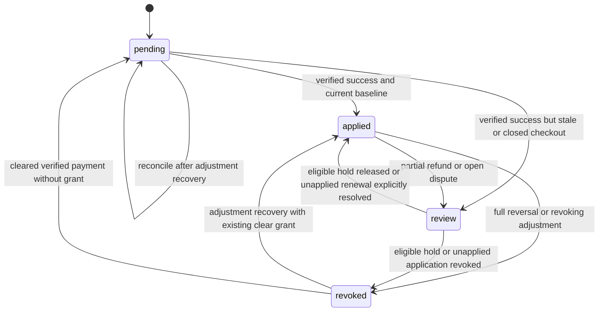

| Trigger | Guard | Effect |
| --- | --- | --- |
| Verified success | Conditional claim accepts pending/failed charge or successful charge still awaiting application. | Mark success; apply a grant only if checkout, baseline and upgrade period are still valid. Otherwise application becomes review without creating a grant. |
| Adjustment | Reducer computes clear/review/revoked. | Update only the corresponding grant; a clear verified payment without a grant returns to pending for reconciliation. |
| Manual release/revoke | Super admin, bounded reason, existing matching grant, lifecycle access is review, and adjustments array exists. | Persist fingerprint-bound review, grant state, application status and audit in the transaction. |

**Separate resolution paths:** `reviewPayment` handles an existing grant with an adjustment hold. `resolveUnappliedPayment` handles verified successful money in application review without a grant and without an outstanding provider hold. Both require super admin and an audited reason. The unapplied path reverifies gateway facts/adjustments, appends a renewal after existing paid base periods, or revokes application without issuing a refund. Stale prorated upgrades cannot be applied with their old price. A separate lifecycle applicationReview decision survives adjustment recalculation, preventing revoked unapplied money from being granted later.

### B04 Refund and reversal facts and B05 disputes

**Owner:** [applyAdjustment and provider event parser](../src/giving/services/payment-lifecycle.ts).

**Stored:** lifecycle JSON adjustment entries keyed by kind/id, with state, amount, currency, timestamp and dispute stage.

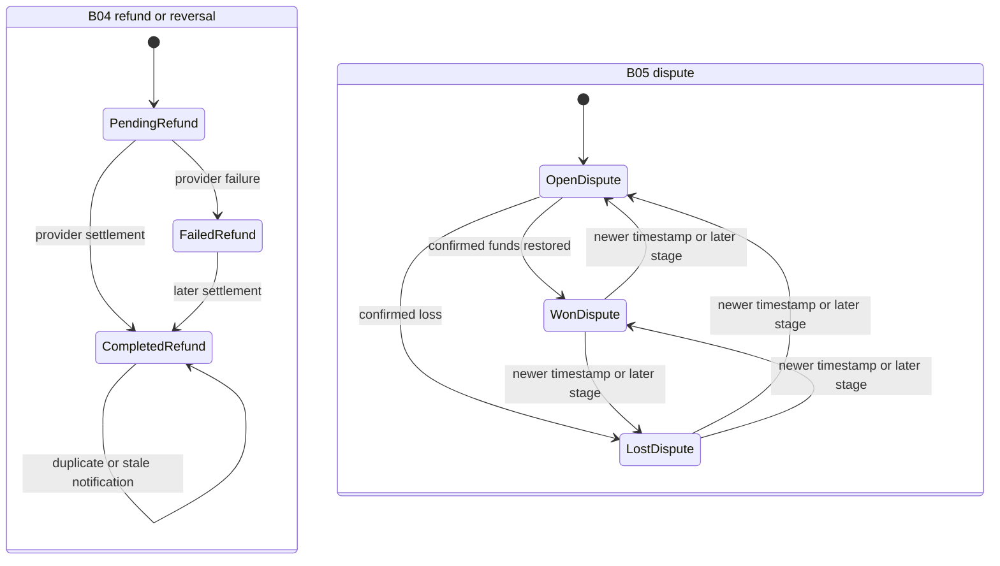

| Input | Guard | Result |
| --- | --- | --- |
| Any adjustment | Identifier; matching currency; finite bounded amount; aggregate refunds cannot exceed original charge. | Merge by kind/id rather than append duplicates. |
| Stale callback | Terminal facts, timestamps and dispute stage ordering determine staleness. | Retain prior fact instead of blindly overwriting it. |
| Completed refund | An established completed refund/reversal with known amount cannot be downgraded by delayed updates. | Financial facts remain monotonic for that adjustment. |
| Conflicting final dispute | A newer timestamp or later recognized stage is required, subject to stale-timestamp rejection; reopening also has freshness/stage checks. | A later dispute stage can change an earlier final outcome. |
| Provider parsing | Provider-specific event/status semantics. | Flutterwave bare `completed` is initiation, not proof of disbursement; recognized settlement variants are completed. Unknown dispute outcomes remain held. |

Pending/failed are nonterminal facts in the reducer, not an enforced linear workflow. Its merge rules can replace nonterminal values when not stale. Dispute stages rank new, second, pre-arbitration and arbitration; they are ordering metadata rather than separate application states.

### B06 Financial access decision

**Owner:** [applyAdjustment](../src/giving/services/payment-lifecycle.ts#L46).

**Derived and persisted projection:** lifecycle `access = clear | review | revoked`; `financialReversal` and refunded total are derived from merged facts.

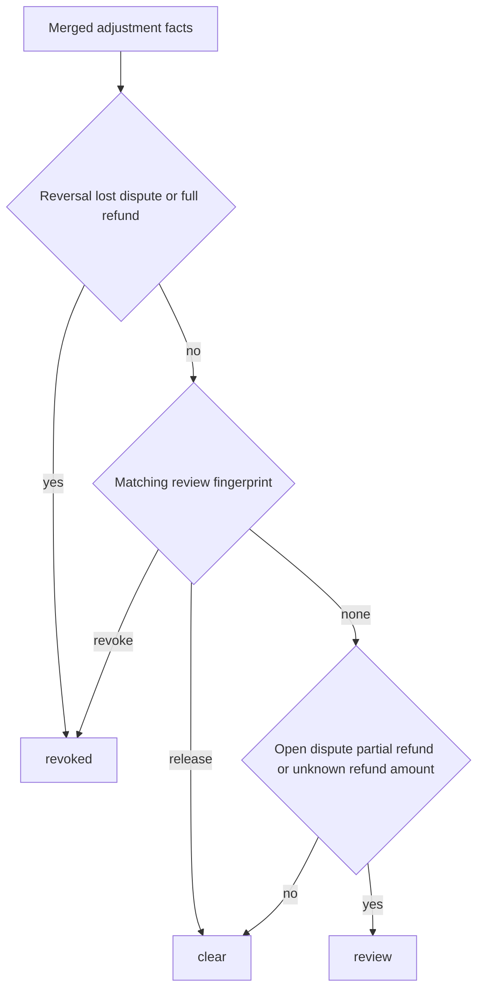

A review decision applies only while its adjustment fingerprint still matches. New facts force recalculation. A full financial reversal takes precedence over a release decision. Giving transactions reuse this reducer; it is not exclusive to subscriptions.

### B07 Access grants and B08 workspace entitlement

**Owner:** [grant selection](../src/billing/payment-access.ts), [entitlement projection](../src/billing/entitlements.ts), [read/write policy](../src/billing/subscription-access.ts).

**Stored:** grants with start/end, plan/cycle, reference, clear/review/revoked state and optional upgrade flag. **Derived:** future/current/expired coverage, selected grant, active/readOnly access.

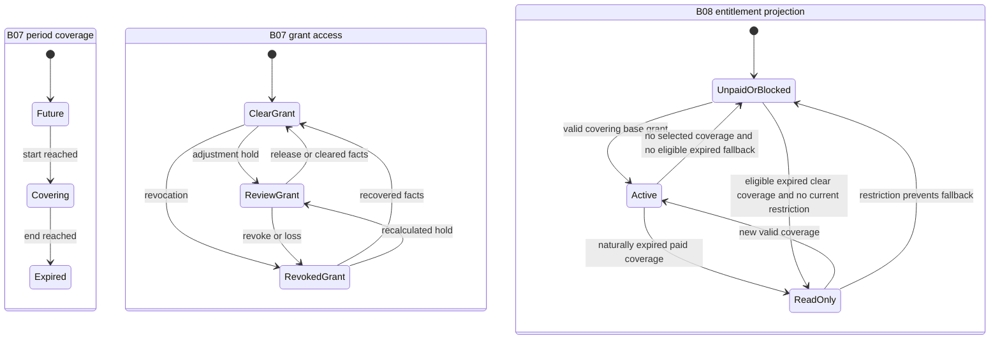

| Projection | Rule and consequences |
| --- | --- |
| Selected grant | Covering clear base grant is required; the latest valid covering upgrade can override it. An upgrade alone is not a base subscription. |
| Held/restricted | Review contributes a held flag; any covering non-clear grant prevents the natural-expiry read-only fallback. Do not equate held and inactive: separately valid grants may still exist. |
| Read-only | No active selection, legitimately expired clear coverage, and no current restriction. Legacy `paid_until` is supported when grants are untracked. |
| Read/write guard | Normal role, tenant and feature checks remain. Reads include GET/HEAD/OPTIONS and report export POST; billing and designated auth writes have exemptions. |
| Time transition | Coverage changes without a DB status update. Renewals preserve independently paid periods; refunding one payment changes its own grant. |

### B09 Renewal preference

**Owner:** [schedule and reconciliation](../src/billing/billing.service.ts#L273).

**Stored:** `scheduled_plan`, `scheduled_cycle`, independently of the current plan.

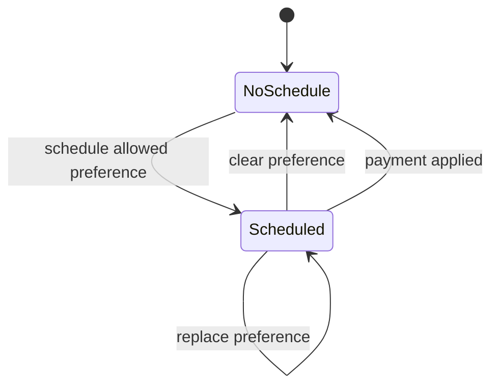

Setting a preference requires an active paid period, a non-upgrade plan and no pending open checkout, under the church lock. Clearing uses null. Scheduling does not itself collect money or change the current paid plan; application clears the preference.

## Giving and ticketing

### B10 Giving transaction

**Owner:** [verification and settlement](../src/giving/giving.service.ts#L573), [adjustments](../src/giving/giving.service.ts#L754).

**Stored:** pending/success/failed/reversed status, payment identity, metadata lifecycle, receipt number. Cash/bank transactions start successful.

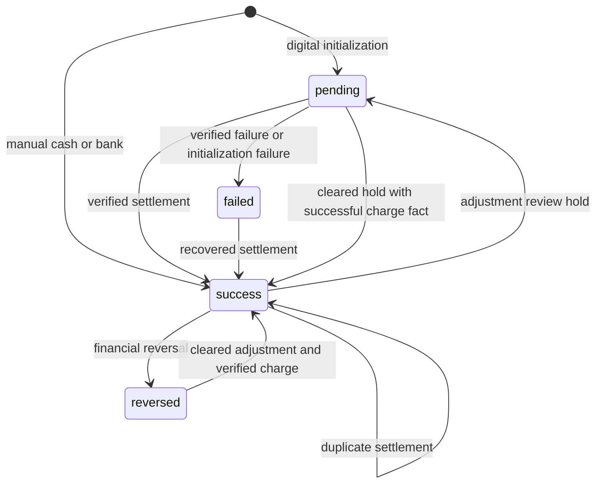

| Trigger | Guard and effects |
| --- | --- |
| Verify | Gateway/account-bound identity and exact payment details; pending verification is a no-op. Settled success is not downgraded by an ordinary failed status. |
| Settle | Transaction rereads the row; reversed/review/revoked lifecycle facts prevent an ordinary success callback bypassing the hold. Successful settlement creates/retains the receipt and fulfills linked registration/ticket state. |
| Adjust | B04 through B06 recalculate access and charge projection; registration/ticket invalidation or restoration occurs in the same transaction as the adjustment updates. |

### B11 Recurring giving

**Owner:** [cancel, pause, resume and processRecurringCharge](../src/giving/giving.service.ts#L1692), [nightly dispatch](../src/queues/processors/nightly-jobs.processor.ts).

**Stored:** `is_active`, `paused_at`, authorization, merchant account binding, failure counter and charge dates.

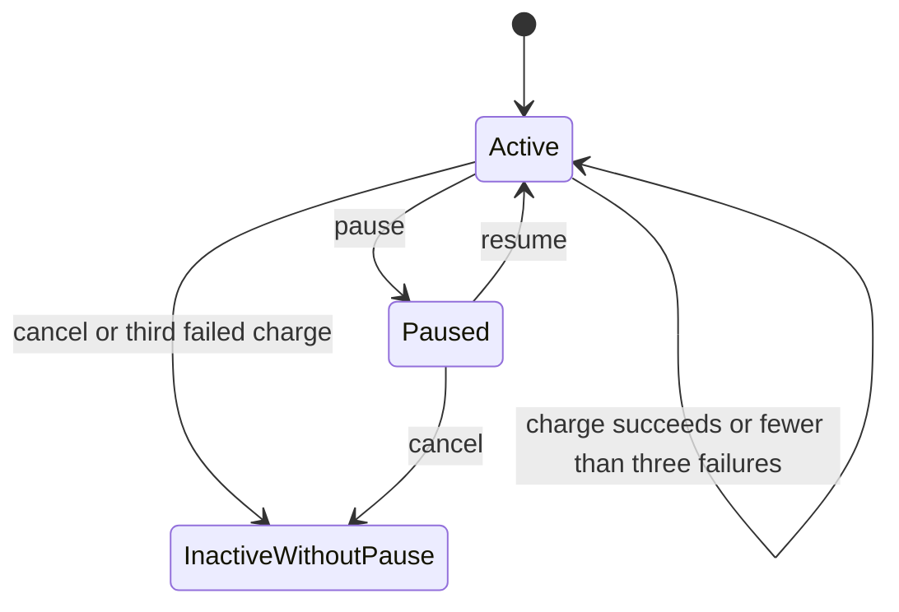

| State/event | Encoding, guard and effects |
| --- | --- |
| Active | `is_active=true`. A charge also requires authorization and the same configured merchant account; unavailable routing skips charging. |
| Paused | `is_active=false` and `paused_at` set. Only this inactive form can resume. |
| Cancelled or failure-disabled | `is_active=false` and no pause timestamp. The same encoding covers explicit cancellation and ordinary automatic disablement after three failures. Resume rejects it. |
| Charge result | Success resets failure count and advances next date. Failure increments count and retains next due date; a caught charge error also increments/disables. |

The counter distinguishes some history but is not a separate stored failure-reason enum. Dispatch eligibility and due-date selection are separate from whether a queued job eventually succeeds.

### B12 Event registration payment and B13 ticket validity

**Owner:** [EventsService](../src/events/events.service.ts#L1082), [giving fulfillment and adjustments](../src/giving/giving.service.ts#L716), [registration cancellation](../src/events/events.service.ts#L1880).

**Stored:** registration `payment_status`, transaction/ticket references; ticket `status`. Schema vocabulary includes registration pending/paid/failed/refunded and ticket reserved/paid/cancelled/refunded. These vocabularies do not establish every possible transition.

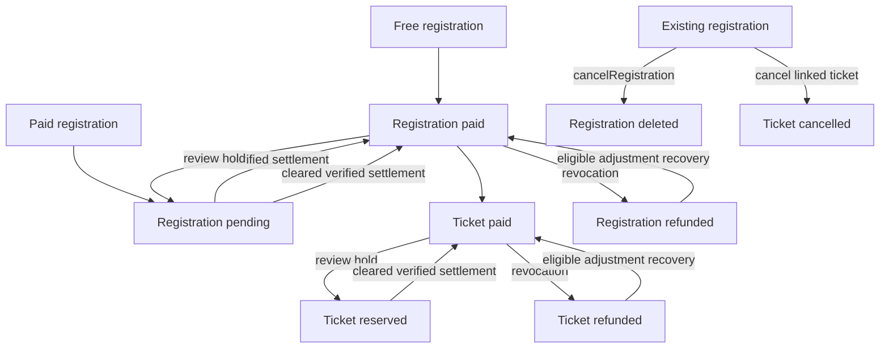

Settlement is conditional/idempotent and verifies the linked payment. Adjustment recovery restores eligible reserved/refunded tickets, not cancelled tickets. Cancellation deletes the registration and marks its linked ticket cancelled; it does not request a provider refund. Do not infer automatic expiry or a reserved-ticket creation path merely from enum defaults.

### B14 Ticket ownership and B15 ticket consumption

**Owner:** [assignment and self-claim](../src/events/events.service.ts#L1440), [validateTicket](../src/events/events.service.ts#L1702).

**Stored:** ticket member/visitor ownership, registration linkage and `is_used`/`used_at`.

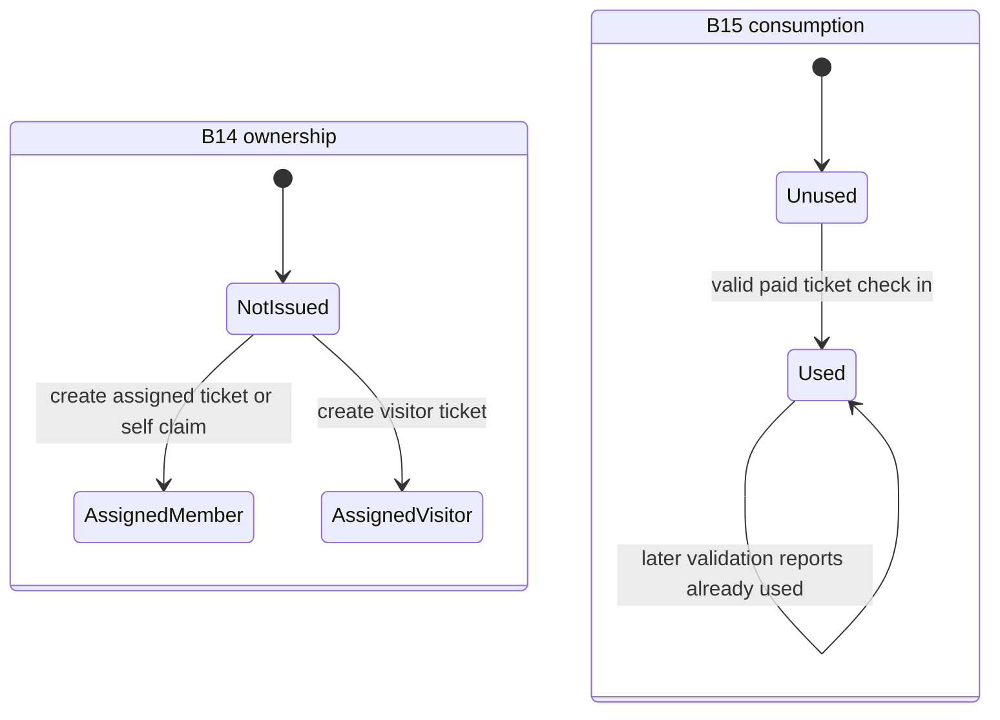

The ownership diagram summarizes issuance and assignment branches, not an assertion that tickets first exist unassigned or that reassignment is supported. Assignment/self-claim validates scope, identity, capacity and existing bookings. Some creation paths issue tickets already attached to a member.

Check-in requires matching event, paid status and unused flag. The transactional conditional update repeats paid/unused predicates and creates attendance for linked people. Financial/ownership changes are separate from consumption; no automatic used-to-unused transition is shown.

## People and review workflows

### B16 Member status and B17 visitor follow-up

**Owner:** [MembersService](../src/members/members.service.ts#L392), [visitor statuses](../src/visitors/dto/create-visitor.dto.ts#L22), [visitor conversion](../src/visitors/visitors.service.ts#L516).

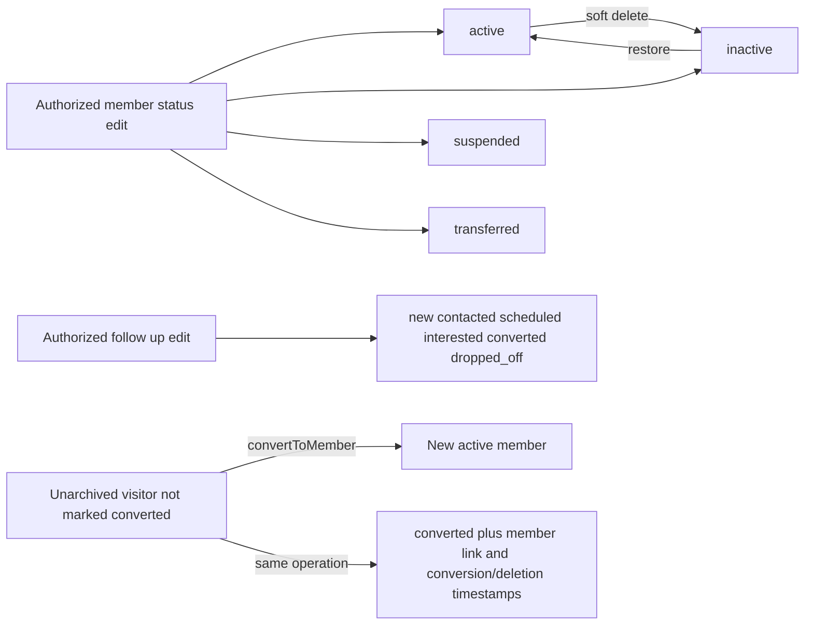

These are mostly direct-edit status sets, not enforced linear pipelines. Conversion locks the visitor and rechecks scope/archive state. An existing converted member link returns the original result on retry. Member creation, visitor linkage/timestamps and the conversion audit commit in one transaction; notifications run after commit. A legacy converted status without a member link still rejects conversion. Converted visitors are excluded from active visitor pulls using `deleted_at`. Archive/restore is B27.

### B18 Public people intake

**Owner:** [accept and reject](../src/intake/intake.service.ts#L293).

**Stored:** pending/accepted status, answers, destination, reviewer and review time; rejection is deletion.

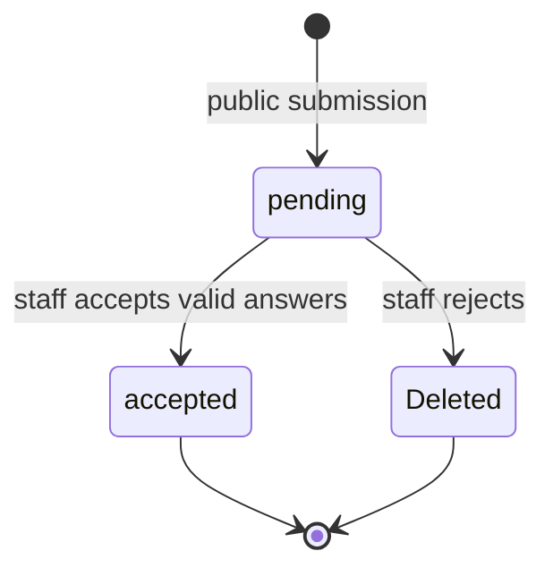

Accept/reject serialize through a church row lock. Accept checks pending state, active branch and current fields, then creates destination and updates intake in the same transaction. Notifications run after commit. Reject conditionally deletes pending answers and audits metadata; there is no persisted rejected status or restore operation for those answers.

### B19 Form publication and B20 submission review

**Owner:** [form edits](../src/forms/forms.service.ts#L214), [close/reopen](../src/forms/forms.service.ts#L429), [submission review](../src/forms/forms.service.ts#L834).

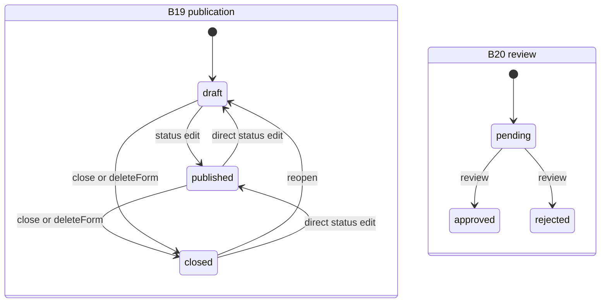

| Operation | Guard and effects |
| --- | --- |
| Update publication | Unarchived, visible form; DTO-valid status can be directly assigned. The named close/reopen methods are not the exclusive writers. |
| Close/reopen | Close rejects already closed; reopen requires closed and sets **draft**, not published. `deleteForm` closes instead of deleting answers. |
| Accept answers | Backend requires published; public intake additionally requires public token/public access and an unarchived form. Required fields, uniqueness/limits and attachments also apply. |
| Review answers | DTO and service accept approved/rejected only. The write requires the matching church/form/submission and pending status; a losing or repeated review returns conflict. Only the winner stamps reviewer/time and audits. Rejection reason remains optional. |

Public visibility, token rotation, template flag and archive state are orthogonal configuration axes. A token existing does not make a draft form fillable.

### B21 Appointments

**Owner:** [create/update/archive/restore/purge](../src/appointments/appointments.service.ts).

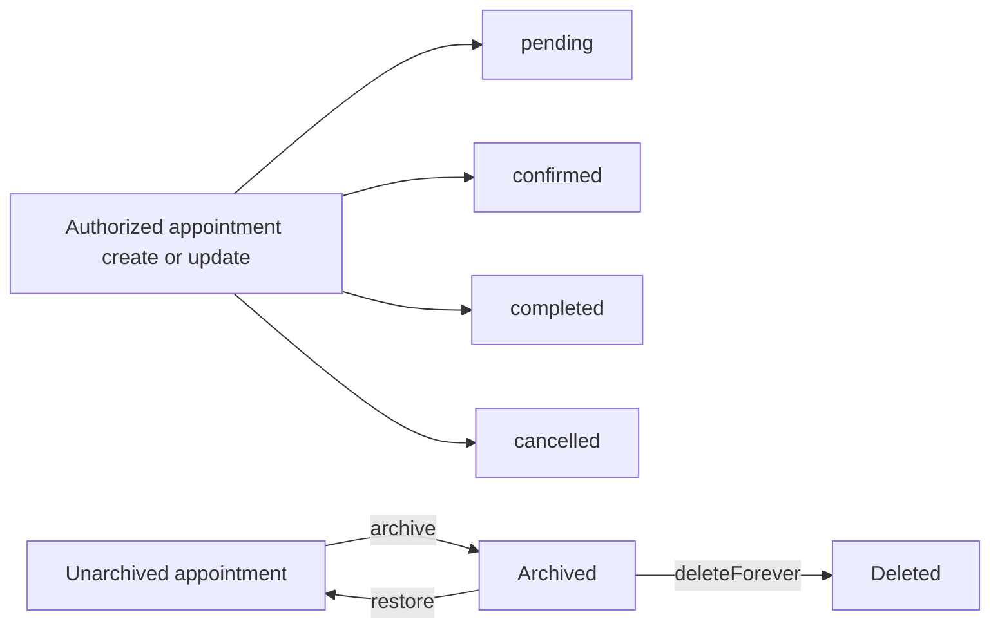

Status is a direct-edit vocabulary rather than an enforced pending-confirmed-completed progression. Party/branch scope and contact validation still govern writes. Archive is independent of booking status; cancellation is not deletion.

## Assets

### B22 Asset lifecycle B23 maintenance and B24 loans

**Owner:** [asset edits/disposal](../src/assets/assets.service.ts#L589), [maintenance](../src/assets/assets.service.ts#L938), [loans](../src/assets/assets.service.ts#L1191), [loan worklist](../src/assets/assets.service.ts#L97).

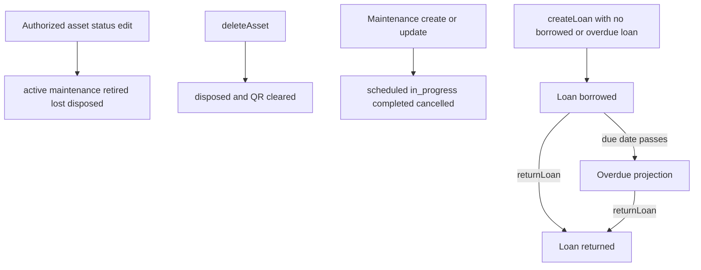

| Machine | State holder and transition semantics |
| --- | --- |
| B22 Asset | Stored status is directly editable; archive is separate. Disposal sets disposed and clears QR. Loan operations do not alter equipment status. New loans require active, unarchived equipment; borrowing is represented by the separate outstanding loan. |
| B23 Maintenance | Stored scheduled/in_progress/completed/cancelled; direct updates, not a guarded progression. This record is separate from the asset's maintenance status. |
| B24 Loan | Stored borrowed/returned/overdue plus expected return date. Lists count a borrowed loan with a past due date as overdue without needing a status write. Creation blocks an existing borrowed/overdue loan; return rejects already returned. |

Loan creation/return lock the asset and perform their checks/write in a transaction. A partial unique index permits one borrowed/overdue loan per asset, including direct database writers. Returning leaves maintenance, retirement and other equipment state intact. Historical maintenance statuses assigned by old loan code are not automatically reclassified. Asset condition and depreciation method are classifications/calculations, not separate guarded workflows.

## Accounts and shared record lifecycle

### B25 Staff account and B26 seat reservation

**Owner:** [profile operations](../src/profile/profile.service.ts#L835), [seat reservation](../src/billing/entitlements.ts#L119), [invitation delivery](../src/company-email/staff-invitation.service.ts).

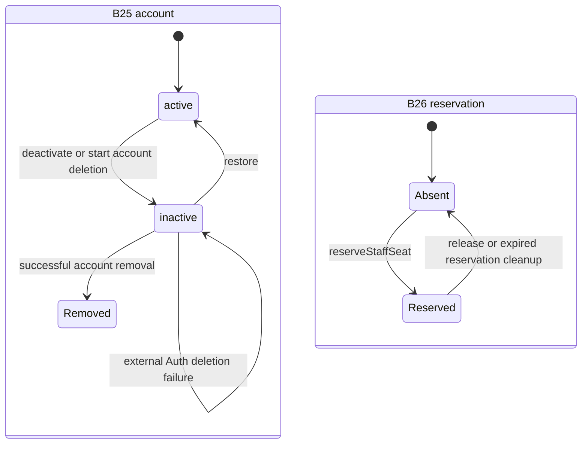

Self-deactivation/removal is forbidden; account removal also protects super admins. Deletion first blocks local access, removes MFA approvals and fails pending account email before contacting Auth. External failure leaves a retryable inactive profile. Archive state is independent.

Seat reservation uses normalized email, uniqueness, church lock and a 15-minute expiry. Expired reservations are cleaned by reservation work; expiry also affects live-seat counting. A reservation records preparation, not invitation acceptance or guaranteed email delivery. The invitation email's delivery state is B33; its browser acceptance is F05.

### B27 Shared archive and B28 enablement

**Owner:** entity services and [Prisma fields](../prisma/schema.prisma).

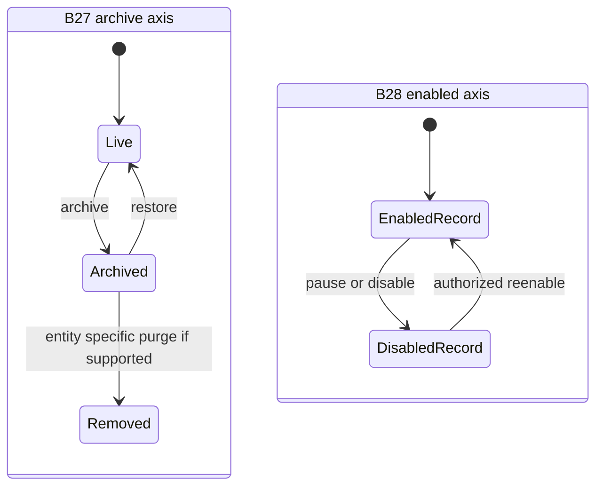

Archive sets/clears `archived_at`; enablement sets `is_active`. They are independent, with entity-specific behavior. The generic purge arrow is not a promise that every entity supports purge or has the same preconditions.

| Instances | Owning service |
| --- | --- |
| Churches and branches | [church](../src/church/church.service.ts), [branches](../src/branches/branches.service.ts) |
| Profiles, members, visitors and families | [profiles](../src/profile/profile.service.ts), [members](../src/members/members.service.ts), [visitors](../src/visitors/visitors.service.ts), [families](../src/family/family.service.ts) |
| Services and custom field definitions | [attendance](../src/attendance/attendance.service.ts), [custom fields](../src/custom-fields/custom-fields.service.ts) |
| Giving categories | [giving](../src/giving/giving.service.ts) |
| Events and ticket tiers | [events](../src/events/events.service.ts) |
| Departments and cell groups | [admin](../src/admin/admin.service.ts) |
| Sermons, pastoral notes and life events | [sermons](../src/sermons/sermons.service.ts), [pastoral](../src/pastoral/pastoral.service.ts) |
| Asset categories and assets | [assets](../src/assets/assets.service.ts) |
| Forms, appointments and templates | [forms](../src/forms/forms.service.ts), [appointments](../src/appointments/appointments.service.ts), [templates](../src/templates/templates.service.ts) |
| Webhook subscriptions | [webhooks](../src/webhooks/webhooks.service.ts) |
| Integration accounts | [integration accounts](../src/integrations/integration-accounts.service.ts); archival is mapped, no symmetric restore is implied. |

B28 applies to services, giving categories, custom fields and webhook subscriptions. Recurring giving has its richer B11 encoding. Member/profile soft deletion, visitor conversion and asset disposal use their own machines rather than a universal `deleted_at` rule.

## Communication and provider integrations

### B29 Template publication

**Owner:** [TemplatesService](../src/templates/templates.service.ts#L191), [schema](../prisma/schema.prisma#L1173).

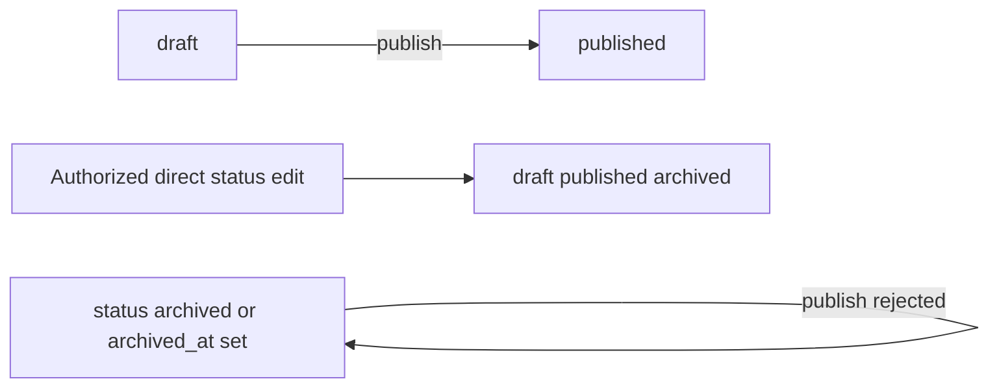

`publish` rejects already published, archived status and timestamp-archived templates. General update also accepts status, so this is not an exclusive publish-only machine. `external_status` carries provider approval vocabulary APPROVED/PENDING/REJECTED; it is a separate optional field, not evidence that this service implements a full provider approval progression.

### B30 Broadcast campaign and B31 recipient enqueue outcome

**Owner:** [create/update](../src/broadcast/broadcast.service.ts#L102), [cancel/processBroadcast](../src/broadcast/broadcast.service.ts#L353).

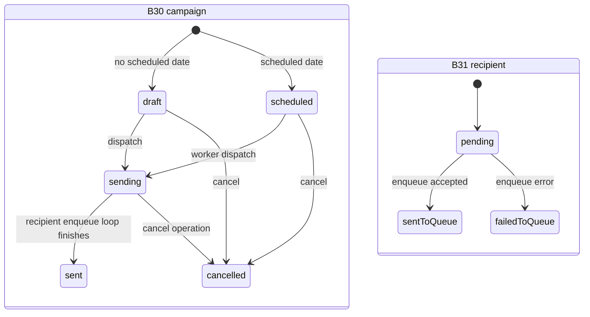

Campaign and recipient stored value is `sent`, not the descriptive `sentToQueue` diagram label. It means enqueue completion here, not confirmed provider delivery. The campaign becomes sent even when some recipients fail. A failed campaign value is documented in the schema, but this processing path does not set it merely because recipients fail.

`cancel` rejects sent/cancelled and locks the campaign. Each recipient enqueue uses the same campaign lock, rechecks sending/pending state, and uses a stable BullMQ job ID. Final completion is conditional on sending, so it cannot overwrite cancellation. Already accepted outbound jobs may still deliver. Queue acceptance and PostgreSQL commit are separate systems: stable IDs deduplicate replay while the queue retains the job; this is not a permanent exactly-once delivery guarantee. Queue processing and provider callbacks continue in B32/B34. The UI labels stored sent as Queued.

### B32 Message delivery B33 company outbox and B34 queue execution

**Owner:** [message schema](../prisma/schema.prisma#L1149), [provider callbacks](../src/integrations/integration-callbacks.controller.ts), [company email dispatcher](../src/company-email/company-email.service.ts#L138), [queue processors](../src/queues/processors/whatsapp-outbound.processor.ts).

```mermaid
flowchart TD
    QueueWaiting[B34 queued or delayed] --> QueueActive[processing]
    QueueActive --> QueueDone[completed]
    QueueActive -->|retry budget remains| QueueWaiting
    QueueActive -->|budget exhausted| QueueFailed[failed]
    QueueFailed -->|WhatsApp and configured fallback| SMS[SMS fallback attempt]
    QueueActive --> Sent[B32 message sent]
    Callback[Provider delivery callback] --> Delivery[sent delivered read failed]
    OutboxPending[B33 pending] -->|available and lease claim| OutboxSending[sending]
    OutboxSending -->|provider accepted| OutboxSent[sent]
    OutboxSending -->|retryable error| OutboxPending
    OutboxSending -->|expired lease| OutboxSending
    OutboxPending -->|budget or delivery window exhausted| OutboxFailed[failed]
    OutboxSending -->|final provider error or expired window| OutboxFailed
```

| Machine | Guard and effects |
| --- | --- |
| B32 Provider message | Status vocabulary is sent/delivered/read/failed; callback mappings are provider-specific. Do not assume strict monotonic ordering or infer delivery from the queue/campaign status. |
| B33 Company email | Conditional lease claim accepts pending/sending with due `available_at` and absent/expired lease. Lease token fences completion writes. Sent rows are skipped; retries use exponential delay, attempt limit and delivery window. Provider idempotency key and immutable message snapshot are retained. Missing provider configuration leaves work pending. |
| B34 Queue job | BullMQ owns waiting/delayed/active/completed/failed and retry timing. A processor exception and a business-row status are distinct. WhatsApp fallback occurs only at final failure when enabled and a plain-text body exists; fallback failure is logged. |

Company-email `sent` means provider acceptance, not recipient delivery. Its recovery scanner has a process-local scanning flag; the database lease is the cross-worker ownership mechanism. Queue completion is not proof that a charge, call or email reached its ultimate business outcome.

### B35 Webhook delivery

**Owner:** [subscription operations](../src/webhooks/webhooks.service.ts), [delivery processor](../src/webhooks/webhook-delivery.processor.ts).

```mermaid
stateDiagram-v2
    [*] --> pending
    pending --> success: HTTP 2xx
    pending --> failed: exception or subscription unavailable
    failed --> success: later queue retry succeeds
    failed --> failed: later attempt fails
```

The processor rechecks subscription existence, enablement, archive and current plan before sending. It increments attempts, signs the payload and records success on 2xx. `onFailed` writes failed for an attempt; BullMQ may still retry that job. `next_retry_at` being present in the schema does not make it the actual queue retry clock.

### B36 Credential verification and B37 channel routing

**Owner:** [IntegrationAccountsService](../src/integrations/integration-accounts.service.ts#L184), [provider verification](../src/integrations/provider-transport.service.ts).

```mermaid
flowchart TD
    Unchecked[unchecked] -->|verify| Verified[verified]
    Unchecked -->|verify| Limited[limited]
    Unchecked -->|verify| Rejected[rejected]
    Reverify[Reverify existing account] --> Verified
    Reverify --> Limited
    Reverify --> Rejected
    Disabled[B37 disabled] -->|compatible verified or limited account| Custom[custom]
    Custom -->|disable| Disabled
    Custom -->|configure another eligible account| Custom
```

B36 stores verification status and checked timestamp. Reverification is a fresh result, not a one-way approval ladder. B37 stores mode/provider/account/settings; current configuration accepts custom or disabled. Historical platform-mode descriptions are not a current selectable mode here. Archival and plan availability independently constrain resolution. Historical payment account binding is preserved for settlement and is not changed by selecting a new current route.

### B38 Internal email copies and B39 notifications

**Owner:** [EmailService](../src/email/email.service.ts#L285), [NotificationsService](../src/notifications/notifications.service.ts#L102).

```mermaid
stateDiagram-v2
    state "B38 read axis" as ReadAxis {
        [*] --> Unread
        Unread --> Read: open or mark read
        Read --> Unread: mark unread
    }
    state "B38 trash axis" as TrashAxis {
        [*] --> Visible
        Visible --> Trashed: trash own copy
        Trashed --> Visible: restore own copy
        Trashed --> Removed: deleteForever
    }
    state "B39 notification" as Notification {
        [*] --> NotificationUnread
        NotificationUnread --> NotificationRead: mark read
        NotificationRead --> NotificationUnread: bulk mark unread
        NotificationUnread --> NotificationRemoved: remove
        NotificationRead --> NotificationRemoved: remove
    }
```

Email read/trash uses timestamps, independently per recipient and for the sender's sent copy. Opening recipient detail can mark it read. Purge requires the caller's copy to be trashed; it does not equate another recipient's copy with the sender's trash state. Notification operations scope to the recipient profile; removal is a distinct operation from marking read.

## Synchronization

### B40 Server change feed and B41 offline mutation receipts

**Owner:** [SyncService](../src/sync/sync.service.ts#L240), [OfflineService](../src/sync/offline.service.ts#L135), [browser offline machines](../../BelivrHQ-Web/docs/STATE-MACHINES.md#offline-workspace).

```mermaid
flowchart LR
    Change[B40 incoming change] --> Replay{Already applied}
    Replay -->|yes| Skip[Skip duplicate]
    Replay -->|no| Resolve[Validate and resolve timestamp conflict]
    Resolve --> Accepted[Apply and queue change]
    Resolve --> Rejected[Reject or report conflict]
    Accepted --> Unsynced[Queue row synced false]
    Unsynced -->|markSynced| Synced[synced true]
    Synced -->|retention cleanup| Removed[Removed feed row]
    Mutation[B41 mutation ID and payload hash] --> Receipt{Receipt exists}
    Receipt -->|same hash| Return[Return saved acknowledgement]
    Receipt -->|different hash| Reject[Reject reused ID]
    Receipt -->|no| Apply[Validate and apply under advisory lock]
    Apply --> Save[Commit accepted conflict or rejected receipt]
    Apply -->|infrastructure failure| Retry[Return retry without committed effect]
```

B40 uses idempotency and last-write-wins conflict handling. Cleanup also removes very old feed rows according to its separate retention condition; synced is not a permanent archive.

B41 is a distinct protocol, not the same queue. It serializes church/profile/mutation-ID replays, commits the effect and receipt together, and can durably remember conflict/rejection results. Matching replay returns that result instead of retrying the business mutation. Authorization/subscription errors are rejected; infrastructure errors remain retryable. Browser F19/F20 handles those acknowledgements and preserves pending local data.

## Authentication and upload authorization

### B42 Login challenges B43 enrollment B44 session approval and B45 recovery codes

**Owner:** [AuthService challenge completion](../src/auth/auth.service.ts#L505), [AuthenticatorService](../src/auth/services/authenticator.service.ts).

```mermaid
flowchart TD
    Password[Password verified] --> Kind{Required authentication path}
    Kind -->|local authenticator| Login[B42 login challenge]
    Kind -->|legacy provider| Legacy[Provider migration challenge]
    Kind -->|legacy email| Email[Email migration challenge]
    Legacy -->|provider code and consume challenge| Enroll[B43 enrollment challenge]
    Email -->|email code and consume challenge| Enroll
    Login -->|code matches current revision| Approve[B44 session approval]
    Enroll -->|valid TOTP and consume setup| Enabled[Authenticator created and flags enabled]
    Enabled --> Approve
    Enabled --> Codes[B45 recovery codes issued]
    Login -->|TTL or attempt budget| Restart[Password sign in required]
    Enroll -->|TTL or attempt budget| Restart
    Approve -->|expiry revision change or removal| Unapproved[Session no longer approved]
    Codes -->|use matching code once| Consumed[Code removed from hashes]
    Codes -->|regenerate after verification| Replaced[Old set replaced]
    Enabled -->|verify then disable| Disabled[Authenticator removed and approvals deleted]
```

| Machine | Stored state and guards | Effects and recovery |
| --- | --- | --- |
| B42 Challenge | Redis key with kind login/enroll/supabase-migration; older email pending-login record; TTL, per-challenge attempts and shared account attempt budget. | Successful steps consume keys; provider/email migration issues a new enrollment challenge rather than granting ordinary workspace access immediately. Used/expired/budget-exhausted challenges require restart. |
| B43 Enrollment | Redis pending setup contains owner, encrypted secret and revision; DB authenticator exists only after activation. | Owner/code/session validation and one-time setup consumption precede transactional create, flags, recovery hashes and approval. Concurrent setup cannot upsert over an existing active secret. Disable requires verified code and revision match. |
| B44 Approval | DB user/session/revision/expiry; password-only approval has password-session revision. | Approval lasts 12 hours. Validation requires current revision, matching session and live expiry; account/church availability is also enforced. Password approval is rejected if an authenticator appeared meanwhile. |
| B45 Recovery code | Available hash in the current authenticator revision, then absent after use. | Compare-and-set hash array prevents double use. TOTP separately advances `last_used_step` conditionally. Regeneration replaces the whole code set; disable removes the authenticator. |

A valid JWT and an approved application session are different predicates. Expiry is checked on reads; cleanup deletion is not required for an expired approval to stop authorizing. Browser login/settings presentation is F03/F23.

### B46 Direct media upload authorization

**Owner:** [prepareDirectUpload and completeDirectUpload](../src/media/media.service.ts#L130), [browser transfer](../../BelivrHQ-Web/docs/STATE-MACHINES.md#f07-direct-media-upload).

```mermaid
stateDiagram-v2
    [*] --> Authorized: prepare signed grant
    Authorized --> ObjectPresent: storage PUT succeeds
    Authorized --> Expired: grant time exceeded
    ObjectPresent --> Expired: grant time exceeded before completion
    ObjectPresent --> Registered: complete validates and upserts asset
    Registered --> Registered: replay completion while grant remains valid
```

The signed grant is not a DB upload-status row. It binds owner, church, branch, object, MIME, size and expiry. Complete rechecks authorization/plan/branch and grant validity, then verifies object metadata before upsert. Existing asset returns idempotently, but only after grant authorization checks. An uploaded object can exist without registered metadata if completion fails; no automatic cleanup transition is implied.

### B47 Bot challenge replay protection

**Owner:** [BotProtectionService](../src/bot-protection/bot-protection.service.ts).

```mermaid
stateDiagram-v2
    [*] --> Issued: signed challenge and Redis marker
    Issued --> Consumed: valid scoped proof and atomic consume
    Issued --> Expired: TTL or signed expiry
    Consumed --> Consumed: replay rejected
    Expired --> Expired: proof rejected
```

Proof must match method/path/user scope, algorithm, bounded solution and signature. Verification without an issued Redis marker fails. Consume occurs after proof validation. An invalid proof does not imply the challenge was consumed; backend unavailability is an error, not verified state. Browser proof state is F10.

## Boundaries for future changes

- Review charge, application and access together, but keep their state axes distinct. Closed-checkout application review and adjustment review use separate audited recovery paths.
- Treat direct status editors as writers alongside named lifecycle operations. A neat linear diagram alone would overstate the restrictions on forms, appointments, assets, maintenance, members and templates.
- Preserve the actual atomicity boundaries: ticket consumption, intake review, subscription application, visitor conversion, asset loans, submission review, outbox leases and offline receipts have conditional/transactional protection; a read precheck alone does not provide the same guarantee.
- Compare enqueue, provider acceptance, delivery and business completion separately when changing broadcast, queue, webhook or call behavior.

The frontend map covers browser sessions, checkout coordination, forms, imports, uploads, offline storage, support, assistant and shared UI lifecycles. Classification-only enums such as gender, event type, risk level, asset condition and depreciation method are not treated as additional state machines without transition behavior.
